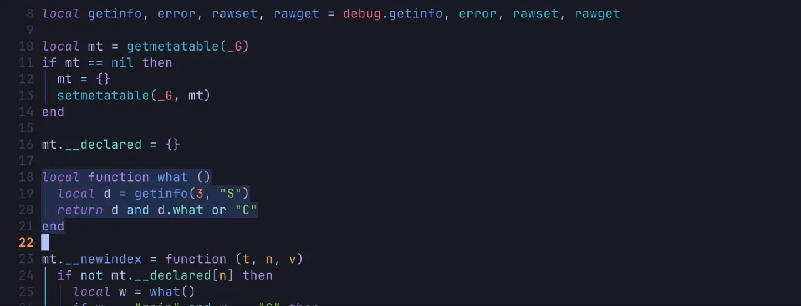

# Shiftlines.nvim

Shift the current line or selected range of lines up or down, while keeping the mark.



> If you would like more features, please check out [mini.move](https://github.com/nvim-mini/mini.move).  

## Features

- Shift the current line up or down, one line at a time.
- Shift the selected range of lines up or down, one line at a time.
- Any marks contained within the lines being shifted are also moved along with them.

## Requirements

- Neovim >= 0.12.4
  - Because it is developed with this version. Since it is simple, I think it will work even in lower versions.
  - Please note that version 0.10 or higher is required to run the tests.

## Installation

Install the plugin with your preferred package manager. Here is an example in [lazy.nvim](https://github.com/folke/lazy.nvim).  
```lua
{
  'AT-AT/shiftlines.nvim',
  opts = {
    -- options...
  },
}
```

## Configuration

Below are the configurable options and their default values.
```lua
{
  -- The user event name emitted after the shift is complete.
  -- The buffer number for which the shift occurred is passed as event data.
  --   e.g., ev.data => { buf_id = 2 }
  ---@type string
  event_name = 'ShiftlinesLineShifted',
}
```

## Key Mappings

This plugin does not provide a default keymap. Below is an example.
```lua
-- Shift the target line(s) up by one line.
vim.keymap.set({ 'n', 'x' }, '<C-Up>', function() require('shiftlines').shift_upward() end)

-- Shift the target line(s) down by one line.
vim.keymap.set({ 'n', 'x' }, '<C-Down>', function() require('shiftlines').shift_downward() end)
```

If you are using Lazy.nvim, you can perform lazy loading at the same time by registering with the `keys` option.
```lua
{
  keys = {
    {
      '<C-Up>',
      function()
        require('shiftlines').shift_upward()
      end,
      mode = { 'n', 'x' },
    },
    {
      '<C-Down>',
      function()
        require('shiftlines').shift_downward()
      end,
      mode = { 'n', 'x' },
    },
  },
}
```

## License

[MIT](LICENSE)
